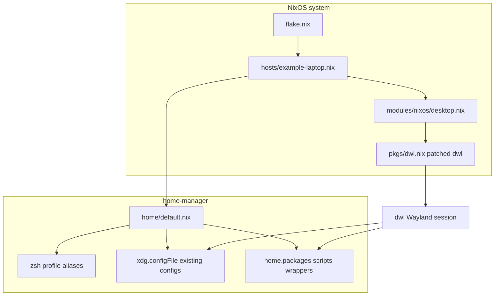

# Migrating these dotfiles to NixOS + Wayland (dwl)

This repo is a LARBS-style **X11 + dwm** rice. Classic `dwm` does not run on
Wayland. The closest keep-the-workflow path is **[dwl](https://codeberg.org/dwl/dwl)**
(dwm for wlroots): same tags/master-stack mental model, same “edit `config.h` +
patches” workflow, declared in Nix.

Target layout in this repo:

- **NixOS** owns the machine (users, PipeWire, graphics, login session).
- **home-manager** owns your user environment (zsh, XDG configs, scripts).
- **dwl** is built from nixpkgs with your `config.h` and a patch list (see
  [`../nix/`](../nix/)).

---

## Mental model: what changes

| Today (Arch + LARBS) | On NixOS + Wayland |
|----------------------|--------------------|
| Clone dots into `$HOME`, install `progs.csv` | One flake: `nixos-rebuild switch` (+ home-manager) |
| Imperative packages (`pacman` / `yay`) | Declarative `environment.systemPackages` / `home.packages` |
| Build suckless into `/usr/local` | `pkgs.dwl.override { configH = … }` + `patches = [ … ]` |
| `~/.zprofile` → `startx` → `dwm` | TTY `exec dwl` or a display-manager Wayland session |
| Mutable `~/.config/*` | Mostly `xdg.configFile` / `home.file` (or keep git-managed trees) |
| Scripts assume FHS `/usr/bin`, `dmenu`, `xclip` | Scripts use `PATH` tools; swap X11 helpers for Wayland ones |
| Statusbar talks to `dwmblocks` | `someblocks` / `dwlb` / patched dwl bar + signal hooks |

Nix does **not** require rewriting every config file into Nix attribute sets on
day one. A good first cut is: ship the existing `.config` trees via
home-manager, and only Nix-ify what must be rebuilt (compositor, packages,
session).

---

## Architecture



---

## Compositor: dwm → dwl (patched)

Keep the suckless workflow:

1. Start from upstream `config.def.h` (or nixpkgs’ default).
2. Put your edited file at [`nix/config/dwl/config.h`](../nix/config/dwl/config.h).
3. Drop patches under [`nix/patches/dwl/`](../nix/patches/dwl/) (from
   [dwl-patches](https://codeberg.org/dwl/dwl-patches)).
4. Wire them in [`nix/pkgs/dwl.nix`](../nix/pkgs/dwl.nix).

Suggested early patch set (adjust to the dwl version you pin):

- **bar** or use external **dwlb** / **someblocks**
- **pertag**
- **vanitygaps** (or equivalent)
- **focusonnetactive** / **monfig** as needed for docks
- **attachbelow** / **alwayscenter** if you used similar dwm patches

nixpkgs already exposes `programs.dwl` (session wrapper + desktop entry). This
scaffold overrides `package` so your patches always win.

**Terminal:** `st` still works via XWayland, but for a native stack prefer
**foot** (or kitty/alacritty) and set `TERMINAL=foot` in the Nix home module.

---

## Component replacement map

### Session / WM stack

| Current | Wayland / Nix replacement | Notes |
|---------|---------------------------|-------|
| `dwm` | `dwl` (patched) | Same workflow; different IPC/signals |
| `dwmblocks` | `someblocks` or `dwlb` | Rewrite `STATUSBAR` and `pkill -RTMIN+N` targets |
| `st` | `foot` (native) or `st` (XWayland) | Update `TERMINAL` / desktop files |
| `dmenu` | `bemenu`, `wmenu`, or `fuzzel` | Nearly every `.local/bin` helper calls `dmenu` |
| `picom` | *(none)* | Compositing is inside dwl/wlroots |
| `slock` | `swaylock` / `waylock` | `sysact` lock path |
| `xinitrc` / `xprofile` / `startx` | `programs.dwl` session + user units | Drop TTY `startx` block in profile |
| `xrdb` / Xresources | terminal + dwl colors | Or keep pywal → foot/mako templates |
| `unclutter` | optional; often unused on Wayland | |
| `remaps` / `setxkbmap` / `xcape` | `services.xserver.xkb` leftovers + dwl/`xkb` options | Caps↔Esc belongs in compositor/xkb |
| `xrandr` / `displayselect` / `screen_layout` | `kanshi` or `wlr-randr` | Your dock layout is machine-specific |
| `xwallpaper` in `setbg` | `swaybg` / `wbg` | Keep the `bg` symlink idea |
| `solaar` | still fine | Keep as a user service |

### Clipboard / screenshots / input

| Current | Replacement |
|---------|-------------|
| `xclip` / `xsel` | `wl-copy` / `wl-paste` (`wl-clipboard`) |
| `maim` + `xdotool` | `grim` + `slurp` (+ `grimblast` helpers) |
| `xset dpms force off` | `wlopm` / compositor idle / `swayidle` |

### Notifications / portals

| Current | Replacement |
|---------|-------------|
| `dunst` | `mako` or dunst with Wayland; wire via home-manager |
| (implicit X11) | `xdg-desktop-portal-wlr` + `xdg-desktop-portal-gtk` |

### Packages / status scripts that are Arch-specific

| Current | On NixOS |
|---------|----------|
| `pacman` / `yay` aliases | `nix`, `nixos-rebuild`, optional `nh` |
| `ifinstalled` → `pacman -Qq` | `command -v` only (already half there) |
| `sb-pacpackages` / `sb-popupgrade` | rewrite for `nix flake metadata` / rebuild reminders, or drop |
| `sb-gpumode` (`optimus-manager`) | NixOS `hardware.nvidia.prime` / `supergfxctl` — machine module |
| Absolute `/usr/share/zsh/plugins/...` | `programs.zsh` plugins from nixpkgs |
| `/usr/bin/highlight`, `/usr/local/bin/st` | never hardcode; rely on `PATH` |

Configs that usually **port as-is** via `xdg.configFile`:

- `nvim`, `lf`, `mpd`, `ncmpcpp`, `mpv`, `zathura`, `newsboat`, `tmux`,
  `fontconfig`, `gtk-3.0`, `wget`, `python`, bookmarks under `shell/`

Configs that are **X11-session specific** (retire or shrink):

- [`../.config/x11/`](../.config/x11/)
- [`../.config/picom/`](../.config/picom/)
- pipewire *user* conf that hardcodes `/usr/bin/pipewire` — prefer NixOS
  `services.pipewire.enable`

---

## How your login flow becomes Nix

**Before**

1. `.zprofile` sets env + `PATH` from `~/.local/bin`
2. On tty1 → `startx $XINITRC`
3. `xinitrc` sources `xprofile` (wallpaper, picom, mpd, dunst, …) then
   `dbus-launch ssh-agent dwm`

**After**

1. home-manager sets the same env (`home.sessionVariables`, `home.sessionPath`)
2. NixOS enables `programs.dwl` (and optionally a greeter)
3. Autostart moves to:
   - dwl `config.h` `startup` / `-s` hook, **or**
   - `systemd.user.services` wanted by `dwl-session.target` / `graphical-session.target`
4. Wallpaper / mako / someblocks / ssh-agent are user units or dwl spawn rules —
   not `xprofile`

---

## Scripts: what to touch first

High-churn helpers (rewrite early; everything else can wait):

1. **`setbg`** — `xwallpaper` → `swaybg`; `xdotool`/dwm refresh → dwl/someblocks signal
2. **`maimpick` / `currscreenshot`** — grim/slurp/wl-clipboard
3. **`sysact`** — `WM=dwl`, `swaylock`, drop `xset`
4. **All `dmenu*` / `prompt` / `mounter`** — call `$MENU` (`bemenu`/`wmenu`) instead of bare `dmenu`
5. **`linkhandler` / `weath`** — `wl-paste` / `wl-copy`
6. **`remaps` / `remapd` / `screen_layout` / `displayselect`** — replace with kanshi + xkb
7. **statusbar/\*** — point at someblocks; rewrite pacman modules

Leave alone until later: media (`mpd`, `ncmpcpp`, `mpv`), `lf`, mail/RSS, most
cron helpers (after `notify-send` still works via mako/dunst).

Pattern that keeps scripts portable:

```sh
MENU="${MENU:-bemenu}"
CLIP_COPY="${CLIP_COPY:-wl-copy}"
# …
"$MENU" -i -p "Mount which drive?"
```

Set `MENU` / `TERMINAL` / `STATUSBAR` once in the home-manager session variables.

---

## Repo layout (scaffold)

```
flake.nix                 # NixOS + home-manager entry
nix/
  hosts/example-laptop.nix
  home/default.nix
  modules/nixos/desktop.nix
  pkgs/dwl.nix            # patched dwl package
  config/dwl/config.h     # your suckless config (edit this)
  patches/dwl/            # .patch files + README
docs/NIX-WAYLAND.md       # this file
```

Existing `.config/` and `.local/bin/` stay the source of truth until you migrate
scripts; home-manager can symlink them from the flake store or from a
working-tree checkout.

---

## Suggested migration order

1. **Boot a minimal NixOS** install (no rice): user, network, git, editors.
2. **Enable PipeWire + graphics** in the host module; confirm TTY login works.
3. **Bring up unpatched dwl + foot + bemenu** from the flake; learn the binds.
4. **Add patches / `config.h`** until it feels like your dwm.
5. **Attach home-manager**: zsh, env vars, symlink configs that are Wayland-safe.
6. **Port the high-churn scripts** listed above; set `MENU`/`STATUSBAR`.
7. **Autostart** mpd/mako/someblocks via user units; delete xprofile/startx path.
8. **Machine-specific bits** last: `screen_layout` → kanshi, NVIDIA/Optimus,
   Bluetooth MAC in `sb-blt`, Zoom conf (keep out of git or use agenix/sops).

---

## Machine-specific / non-portable bits to quarantine

Do not bake these into a shared Nix module without abstraction:

- `.fzf.zsh` and nvim packer paths under `/home/ayham/...`
- `screen_layout` output names
- `statusbar/sb-blt` device MAC / headset name
- `.config/zoomus.conf` (email, device id)
- `tmux-sessionizer` personal directories
- Arch zsh plugin path and pacman status modules

---

## What this scaffold intentionally does *not* do yet

- No full rewrite of `.local/bin` (that is the next hill-climb).
- No `flake.lock` checked in from this environment (Nix was not available here);
  run `nix flake update` on a machine with Nix.
- No secrets management — keep `pass` store outside the flake, or add sops-nix later.
- No declaration of every LARBS package from `progs.csv` — add packages as you
  notice gaps after the first boot.
